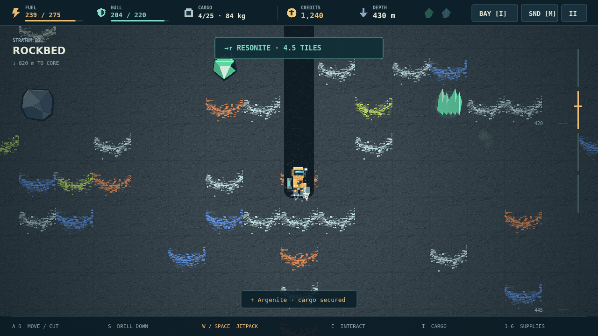

# DEEPCORE

**Depth is cheap. Height is expensive.** Stranded on a dead mining world, you have
a drill, a jetpack, and a derelict launch pad. The planet beneath your boots is
your only ticket home. Cut through its banded rock, sell what you can carry, and
piece together an escape rocket from five hard-earned systems.

Every dig starts with a bargain. A little farther down means richer ore, but a
heavy cargo slows the climb and every second of thrust burns fuel. Carve your
own tunnels, watch the gauges, and decide when a good haul is good enough. Back
at the outpost, the exchange, fuel depot, and engineering shop turn another close
call into a stronger machine.

Below the topsoil, the mine begins to answer back. Pale wisps warn of explosive
gas. Lava churns through the deepstone. Your scanner can find the exotic crystals
your rocket needs, but the final prize waits at the planet's heart: an unstable
Core Sample, and ninety seconds to get it home.

Choose a short, sharp descent or a marathon into the dark. Bank a checkpoint at
the Save Pad in Standard, or put the entire expedition on the line in Hardcore.
There is no enemy to defeat, only a way down to make—and a way back to afford.
